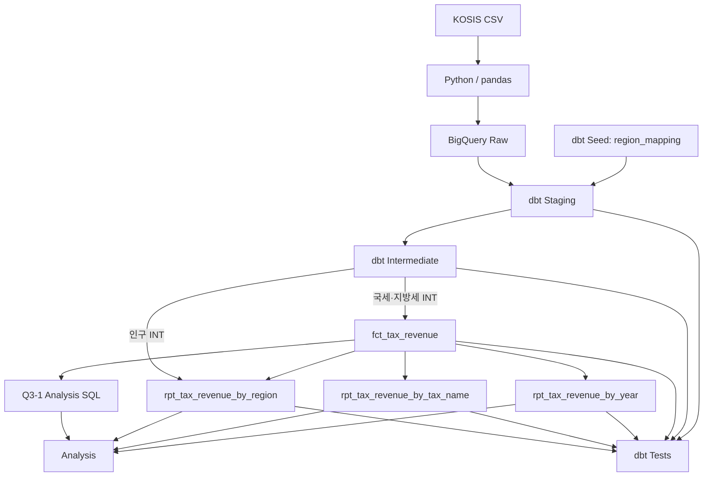

# Tax Revenue Analytics Pipeline

BigQuery와 dbt를 활용하여 국세·지방세·주민등록인구 데이터를 통합하고,  
2020~2024년 재정분권 추진기의 세목별 세수 구조 변화와 지역별 세수 집중도를 비교·분석하기 위한 Analytics Engineering 프로젝트입니다.

---

## 1. 프로젝트 개요

* **도메인:** 세무(국세·지방세) 및 행정(인구) 데이터
* **분석 목적:** 재정분권 추진기 국세·지방세의 세목별 구성 변화와 지역별 세수 집중 구조를 비교하고, 주요 지방세목의 변화가 지역별 세수 분포에서 어떠한 양상으로 나타나는지 파악
* **기술적 목표:** 서로 다른 구조의 국세·지방세·인구 데이터를 통합·표준화하여 분석 가능한 Analytics Warehouse 및 재현 가능한 dbt 기반 데이터 파이프라인 구축
* **분석 기간:** 2020~2024년
* **개발 기간:** 2026년 9월 1일 ~ 진행 중

본 프로젝트는 단순한 통계 분석보다,  
서로 다른 원천 데이터의 grain·지역 체계·세목 체계를 분석 목적에 맞게 정합화하는  
Analytics Engineering 과정에 중점을 둡니다.

---

## 2. 분석 문제 정의

### 분석 주제

**재정분권 추진기 국세·지방세의 세목별 구조 변화와 지역별 세수 집중도 비교**

### 분석 배경 및 목적

우리나라는 지방세원 확충과 중앙정부 재원의 지방 이양 등을 통해 재정분권을 지속적으로 추진해 왔습니다. 특히 2018년 발표된 재정분권 추진방안에 따라 1단계(2019\~2020년)와 2단계(2022\~2023년 주요 제도 시행)에 걸쳐 지방소비세 전환비율이 인상되었습니다.

본 프로젝트는 1단계 재정분권이 마무리된 2020년부터 2단계 주요 제도 시행 이후인 2024년까지 국세·지방세의 세목별 구성과 지역별 세수 집중 구조의 변화를 분석합니다.

특히 지방소비세를 비롯한 주요 세목의 세수 규모와 비중 변화를 살펴보고, 국세와 지방세의 지역별 분포를 비교합니다.

또한 수도권·비수도권의 세수 집중도를 인구 분포와 비교하여 세수 구조의 변화가 지역별 집중 양상의 변화와 함께 나타났는지 확인합니다.

재정분권 정책의 인과효과를 직접 추정하기보다, 정책 추진 기간에 관찰되는 세수 구조와 지역별 분포의 변화 및 차이를 파악하는 데 목적이 있습니다.

### 핵심 분석 질문

**Q1. 국세·지방세의 연도별 세수 구조 변화**
  국세·지방세의 규모와 분석 대상 전체 세수 중 지방세 비중은 2020~2024년 동안 어떻게 변화했는가?

**Q2. 국세·지방세의 주요 세목과 세수 구성 변화**

- **Q2-1. 주요 세목의 규모 및 증감 분석**
  1. 연도별 국세·지방세에서 세수 규모가 큰 주요 세목은 무엇인가?
  2. 연도별 국세·지방세에서 세수 증가액과 감소액이 가장 큰 세목은 각각 무엇인가?

- **Q2-2. 세목별 구성비 변화 분석**
  1. 국세·지방세의 세목 구성비는 연도별로 어떻게 변화했는가?
  2. 지방소비세의 구성비 변화는 다른 지방세목과 비교해 어떤 특징을 보이는가?

**Q3. 국세·지방세의 지역별 세수 집중 구조**

- **Q3-1. 주요 세목의 지역별 세수 집중도 비교**
  2020~2024년 누적 기준 국세·지방세의 주요 세목별 세수는 어느 지역에 집중되어 있으며, 상위 3개 지역의 세수 집중도는 세목 간 어떻게 다른가?

- **Q3-2. 수도권 세수 비중과 인구 비중 비교**
  2020~2024년 수도권의 국세·지방세 전체 및 주요 지방세목(취득세·지방소비세)의 세수 비중은 인구 비중과 비교해 어떤 차이를 보이며, 연도별로 어떻게 변화했는가?

### 분석 접근 방식

국가 단위의 세수 구조 변화에서 출발하여 주요 세목별 구성 및 증감 요인을 살펴보고, 지역별 세수 집중 구조를 단계적으로 분석합니다.

```text
Q1. 전체 세수 구조
    국세·지방세 규모 및 비중 변화
              ↓
Q2. 주요 세목별 구성과 증감
    세목별 구성비 및 전체 세수 증감에 대한 기여 분석
              ↓
Q3. 지역별 세수 집중 구조
    세목별 지역 분포 및 인구 대비 집중도 비교
```

주요 분석 지표:

* 연도별 국세·지방세 규모 및 지방세 비중
* 주요 세목별 세수 규모 및 구성비
* 세목별 전년 대비 증감액 및 증감률
* 국세·지방세 전체 증감에 대한 세목별 기여
* 주요 세목의 지역별 세수 점유율
* 세목별 상위 3개 지역 세수 점유율 합계
* 수도권·비수도권 세수 비중
* 수도권 세수 비중과 인구 비중의 차이(%p)

본 프로젝트의 분석 결과는 조세 구조와 지역별 세수 분포의 변화를 설명하기 위한 것입니다.

재정분권 정책의 인과적 성과나 개별 주민의 실제 세부담을 직접 측정하지 않습니다.

---

## 3. 기술 스택

| 영역 | 기술 |
|---|---|
| Language | SQL, Python |
| Data Warehouse | Google BigQuery |
| Transformation | dbt Core |
| Data Processing | pandas |
| Data Quality | dbt tests, dbt-utils |
| Version Control | Git, GitHub |
| Development Environment | Cursor |

---

## 4. 원본 데이터 및 전처리 기준

모든 분석 데이터는 **KOSIS 국가통계포털에서 취득**하였으며,  
원본 CSV의 의미를 변경하지 않는 범위에서 분석 파이프라인을 구성합니다.

원천 데이터는 upstream에서 최대한 보존하고,  
분석 목적에 따른 지역 병합·세목 제외·aggregation은 downstream에서 명시적으로 수행합니다.

### 4.1. 활용 데이터

#### 1. `national_tax_raw.csv`

* **KOSIS 통계표:** 2.1.3 지역별·세목별 세수 현황 [2005-]
* **기간:** 2020~2024년
* **지역:** 전국 17개 시·도
* **세목:** 「국세기본법」 제2조제1호에 따른 13개 국세 세목
  * 소득세
  * 법인세
  * 상속세
  * 증여세
  * 종합부동산세
  * 부가가치세
  * 개별소비세
    * 원천 데이터에서는 `개별(특별)소비세`로 표기
  * 주세
  * 인지세
  * 증권거래세
  * 교육세
  * 교통·에너지·환경세
  * 농어촌특별세

* **유의사항**
  * 국세 세수실적은 총수납액에서 환급액을 차감한 순수납액 기준으로 집계됩니다.
  * 일부 연도·지역·세목에서는 환급 등의 영향으로 세수실적이 음수로 나타날 수 있습니다.
  * 원천 데이터까지 역추적하여 유효한 값임을 확인한 음수 세수액은 임의로 제거하거나 0으로 치환하지 않고 유지합니다.

#### 2. `local_tax_metro_raw.csv` / `local_tax_provincial_raw.csv`

* **KOSIS 통계표**
  * 1-1. 특별시 및 광역시 징수실적(총괄)
  * 1-2. 도별 징수실적(총괄)
* **기간:** 2020~2024년
* **지역:** 전국 17개 시·도
* **세목:** 「지방세기본법」 제7조에 따른 11개 지방세 세목
  * 취득세
  * 등록면허세
  * 레저세
  * 담배소비세
  * 지방소비세
  * 주민세
  * 지방소득세
  * 재산세
  * 자동차세
  * 지역자원시설세
  * 지방교육세

* **유의사항**
  * 일부 지역·연도의 레저세 세수액은 원천 통계에서 실제 0으로 집계되며, 유효한 값으로 유지합니다.

#### 3. `population_raw.csv`

* **KOSIS 통계표:** 행정구역(읍면동)별/5세별 주민등록인구(2011년-)
* **기간:** 2020~2024년
* **지역:** 전국 17개 시·도
* **성별:** 남 / 여
* **연령:** 5세 단위 연령 구간

### 4.2. Python 전처리

`scripts/preprocess.py`를 통해 원본 CSV의 의미를 변경하지 않는 범위에서  
BigQuery 적재가 가능한 구조로 변환합니다.

주요 처리:

* 다중 헤더 제거
* wide → long 변환
* 불필요한 합계·소계 구조 정리
* 컬럼 구조 정규화
* BigQuery 적재에 적합한 형태로 변환

Python 단계에서는 분석 목적에 따른 비즈니스 로직을 최소화하고,  
의미 기반 transformation은 가능한 한 dbt 모델에서 명시적으로 수행합니다.

### 4.3. 데이터 정합성 원칙

* 2025년은 지방세 통계가 동일한 분석 범위로 확보되지 않아 분석 대상에서 제외
* 원본 데이터와 staging에서는 가능한 한 source의 유효한 정보를 보존
* 동일 entity의 명칭 표준화는 staging에서 수행
* 서로 다른 지역을 하나의 분석 단위로 병합하는 작업은 intermediate에서 수행
* 분석 범위에서 제외되는 세목은 staging에서 삭제하지 않고 intermediate에서 명시적으로 필터링
* 국세와 지방세의 서로 다른 원천 컬럼은 downstream에서 공통 measure인 `tax_amount`로 표준화
* 0 또는 음수라는 이유만으로 유효한 원천값을 이상치로 제거하지 않음

### 4.4. 세수 집계 범위 및 공식 통계 비교

#### 분석 대상

본 프로젝트는 2020~2024년 국세·지방세 징수실적 중  
지역별로 구분 가능한 국세 13개·지방세 11개 법정 세목을 분석합니다.

* **국세:** 「국세기본법」 제2조제1호에 따른 13개 세목
* **지방세:** 「지방세기본법」 제7조에 따른 11개 세목
* **집계 기준:** 원천 통계의 징수실적 연도
* **지역 기준:** 충남·세종을 통합한 16개 분석 지역

따라서 본 프로젝트의 세수 합계는 분석 대상으로 선정한 세목의 합계이며,  
정부가 발표하는 전국 총세수와는 집계 범위가 다릅니다.

#### 제외 항목

| 구분 | 제외 항목 | 제외 사유 |
|---|---|---|
| 국세 | 수입분내국세 | 지역별 배분 불가 |
| 국세 | 지역 미배분 인지세 | 지역별 배분 불가 |
| 국세 | 과년도수입 | 개별 법정 세목으로 구분되지 않음 |
| 국세 | 자산재평가세·전화세·방위세 | 현행 13개 법정 세목 분석 범위에서 제외 |
| 지방세 | 과년도수입 | 개별 법정 세목으로 구분되지 않음 |
| 지방세 | 도축세·도시계획세 | 현행 11개 법정 세목 분석 범위에서 제외 |

국세 인지세 중 지역별로 집계된 금액은 분석 대상에 포함합니다.

과년도수입은 실제 징수실적에 해당하지만 독립된 법정 세목이 아니므로,  
세목별 분석 기준을 일관되게 유지하기 위해 제외합니다.

#### 공식 통계와의 비교

`rpt_tax_revenue_by_year` 모델의 집계액을 정부 공식 통계와 비교한 결과,  
2020~2024년 누적 기준 다음과 같은 차이가 확인되었습니다.

| 구분 | 공식 통계 | 프로젝트 집계 | 차이 |
|---|---:|---:|---:|
| 국세 | 1,706.10 | 1,347.92 | 358.18 |
| 지방세 | 560.00 | 556.95 | 3.05 |

단위: 조 원. 금액은 반올림하여 표시함.

**국세**

* 지역 미배분 수입분내국세: 약 289.88조 원
* 지역 미배분 인지세: 약 2.63조 원
* 과년도수입: 약 19.63조 원
* 그 외 집계 범위 차이: 약 46.04조 원

국세는 지역 미배분 세수가 공식 통계와의 차이에서 큰 비중을 차지합니다.

**지방세**

* 과년도수입 제외 금액: 약 3.01조 원
* 과년도수입 포함 시 프로젝트 집계액: 약 559.96조 원
* 공식 통계: 560.00조 원

지방세는 과년도수입을 포함하면 공식 통계와 거의 일치합니다.

검증 결과를 바탕으로 과년도수입의 추가 반영을 검토했으나,  
현재 프로젝트에서는 법정 세목별 분류를 유지하기로 결정하였습니다.

따라서 본 프로젝트의 지방세 비중과 세수 증가율은 선정한 세목의 징수실적을 기준으로 계산한 지표이며, 공식 전국 총세수 및 지방세 비중과 집계 범위가 다릅니다.

공식 통계와 비교한 결과, 프로젝트의 지방세 비중은 지역 미배분 국세 등의 제외로 인해 약 4.2~4.7%p 높게 나타났습니다. 다만 2020~2022년 하락, 2022~2024년 반등이라는 연도별 변화 방향은 공식 통계와 일치하였습니다.

따라서 비중의 절대 수준은 공식 통계와 동일하게 해석하지 않되, 집계 범위의 한계를 명시한 상태에서 세수 구조의 연도별 변화 추이를 분석합니다.

상세한 집계 차이 검증과 추세 비교는 [GitHub Issue #7](https://github.com/Kai07790/dbt_project_1_tax/issues/7)에 기록하였습니다.

---

## 5. 데이터 아키텍처



위 다이어그램은 완료된 모델과 예정된 모델을 함께 표시한 최종 설계입니다.

### 데이터 흐름

```text
KOSIS CSV
    ↓
Python 구조 전처리
    ↓
BigQuery Raw
    ↓
dbt source
    ↓
Staging
    ↓
Intermediate
    ├── 국세 INT ──┐
    │              ├── fct_tax_revenue
    ├── 지방세 INT ┘         │
    │                       ├── rpt_tax_revenue_by_year
    │                       ├── rpt_tax_revenue_by_tax_name
    │                       ├── rpt_tax_revenue_by_region
    │                       └── 별도 Analysis SQL
    │                                  │
    └── 인구 INT ────────── rpt_tax_revenue_by_region
                                       │
                                       ↓
                                    Analysis
```

### BigQuery Dataset 구성

```text
tax_admin_raw
└── source가 참조하는 원천 테이블

tax_admin_staging
└── dbt staging models

tax_admin_intermediate
└── dbt intermediate models

tax_admin_seeds
└── dbt seed reference tables

tax_admin_marts
├── fct_tax_revenue
├── rpt_tax_revenue_by_year
├── rpt_tax_revenue_by_tax_name
└── rpt_tax_revenue_by_region
```

### 모델링 전략

dbt의 Staging → Intermediate → Marts 구조를 기반으로  
원천 데이터 정제와 비즈니스 분석 모델을 분리합니다.

Staging에서는 원천 데이터의 구조와 정보를 가능한 한 보존하고,  
Intermediate에서는 국세·지방세·인구 데이터를 분석 목적에 맞는 공통 grain으로 변환합니다.

이후 통합 Fact 모델을 기반으로 분석 목적별 Reporting 모델을 구축합니다.

본 프로젝트에서는 지역과 세목의 속성 구조가 비교적 단순하고,  
별도의 dimension 테이블을 여러 분석 모델에서 재사용해야 할 요구사항이 제한적입니다.

따라서 독립적인 dimension 테이블을 필수적으로 생성하지 않고,  
분석에 필요한 비즈니스 차원과 측정값을 최종 모델에 포함하는 방식을 채택합니다.

각 모델의 grain과 데이터 계약을 명확히 정의하고,  
불필요한 모델 간 조인과 중복된 transformation을 최소화합니다.

Reporting 모델은 반복적으로 활용할 분석 지표를 중심으로 구성하며,  
특정 분석 질문에만 필요한 계산은 별도 Analysis SQL로 처리합니다.

---

## 6. 데이터 모델링

### 6.1. Staging Models

Staging에서는 source 특유의 구조를 정규화하되  
원천 데이터의 유효한 grain과 계층 정보를 최대한 보존합니다.

#### `stg_tax_admin__national_tax`

국세 원천 데이터의 컬럼명, 데이터 타입, 지역 및 세목 계층 구조를 표준화합니다.

**Grain**

```text
tax_year
× regional_tax_office
× region
× tax_category_level_1
× tax_category_level_2
× tax_category_level_3
× tax_category_level_4
× tax_category_level_5
× tax_category_level_6
```

동일 지역이 복수 지방국세청에 걸쳐 집계될 수 있으므로  
`regional_tax_office`를 grain에 포함합니다.

예를 들어 경기 지역은 원천 데이터에서 중부청과 인천청에 각각 존재하므로  
`tax_year × region × tax_name`만으로는 staging 행을 유일하게 식별할 수 없습니다.

주요 처리:

* 컬럼명 및 타입 표준화
* 세수액 원 단위 변환
* 지방청·지역 구조 정리
* 원천 세목 hierarchy 보존
* 계층 1~6단계 중 구조적 `소계` 값을 제외한 실질 세목명을 `effective_tax_category_name`으로 추출

#### `stg_tax_admin__local_tax_metro`
#### `stg_tax_admin__local_tax_provincial`

특별·광역시와 도 단위로 분리된 지방세 원천 데이터를 동일한 컬럼 구조로 표준화합니다.

**Grain**

```text
tax_year
× region
× tax_category_level_1
× tax_category_level_2
```

동일한 세목명이 서로 다른 상위 분류 아래 반복될 수 있기 때문에  
`tax_category_level_1`과 `tax_category_level_2`를 함께 grain에 포함합니다.

주요 처리:

* 컬럼명 및 타입 표준화
* 세목 hierarchy 보존
* 지역명 표준화
* 세수액 원 단위 변환

#### `stg_tax_admin__population`

주민등록인구 데이터를 표준 분석 구조로 변환합니다.

**Grain**

```text
population_year
× region
× gender
× age
```

주요 처리:

* 지역명 표준화
* 성별 값 정규화
* 연령구간 정규화
* 인구수 타입 변환

---

### 6.2. Seed

#### `region_mapping`

서로 다른 source의 시·도 명칭을 하나의 표준 지역명으로 변환하기 위한 reference table입니다.

```text
raw_region       standard_region
서울특별시        서울
경기도            경기
충청남도          충남
...
```

여러 staging 모델에서 동일한 mapping logic을 재사용하여  
중복된 `CASE WHEN` 로직을 방지합니다.

Mapping key에는 `unique`, `not_null` 등 데이터 품질 테스트를 적용합니다.

---

### 6.3. Intermediate Models

Intermediate에서는 staging에서 보존한 source 구조를  
실제 분석에 사용할 공통 grain으로 변환합니다.

#### `int_tax_admin__national_tax`

**Grain**

```text
tax_year × region × tax_name
```

**최종 컬럼**

```text
tax_year
region
tax_name
tax_amount
```

주요 처리:

* `effective_tax_category_name` 기준으로 분석 대상 13개 국세 세목만 유지
* 상위 집계항목·중간 계층·하위 세목 등 분석 grain과 다른 계층의 행 제외
* 2019년 인천지방국세청 신설 이후에도 원천 데이터에 형식상 잔존하는 `중부청-인천` 행 제거
* 인천청과 중부청에 나뉘어 존재하는 경기 지역 세수를 하나의 경기 지역으로 집계
* 세목 계층 및 지방청 컬럼 제거
* `effective_tax_category_name`을 `tax_name`으로 표준화

이를 통해 복수의 세목 계층 및 지방청 구조를 가진 국세 데이터를  
`연도 × 지역 × 세목` 단위의 분석용 모델로 변환합니다.

#### `int_tax_admin__local_tax`

**Grain**

```text
tax_year × region × tax_name
```

**최종 컬럼**

```text
tax_year
region
tax_name
tax_amount
```

주요 처리:

* 특별·광역시(`metro`)와 도(`provincial`) 데이터를 `UNION ALL`로 통합
* `tax_category_level_2`를 분석용 `tax_name`으로 표준화
* 현행 지방세 세목이 아닌 `도축세`, `도시계획세`, `과년도수입` 제외
* 충남과 세종을 `충남·세종`으로 통합
* 동일 `tax_year × region × tax_name`의 지방세액 합산
* 최종 분석 대상 11개 지방세 세목으로 정리

#### `int_tax_admin__population`

**Grain**

```text
population_year × region
```

**최종 컬럼**

```text
population_year
region
population_count
```

주요 처리:

* 충남과 세종을 `충남·세종`으로 통합
* 성별·연령구간을 제거하고 지역별 총인구로 aggregation
* `population_year × region` 단위의 분석용 인구 모델 생성

전체 인구를 사용하는 현재 분석 목적에 맞춰 aggregation을 수행하며,  
성별·연령별 상세 데이터는 staging에 보존합니다.

추후 상세 인구 분석이 필요해지면 staging으로부터 별도의 intermediate 모델을 구성할 수 있습니다.

---

### 6.4. Fact Model

#### `fct_tax_revenue`

**상태: 완료**

국세와 지방세 intermediate 모델을 하나의 공통 분석 구조로 통합하는 Fact 모델입니다.

**Grain**

```text
tax_year × region × tax_type × tax_name
```

**컬럼**

```text
tax_year
region
tax_type
tax_name
tax_amount
```

주요 처리:

* `int_tax_admin__national_tax`와 `int_tax_admin__local_tax`를 `UNION ALL`로 통합
* `tax_type` 컬럼을 추가하여 국세와 지방세를 명시적으로 구분
* 공통 컬럼명과 데이터 타입 정합성 확인
* 연도·지역·세금 유형·세목 단위의 grain 검증
* 원천 intermediate 모델과 세수 합계 reconciliation

국세와 지방세는 별도 원천에서 관리되지만,  
최종 분석에서는 동일한 측정값인 `tax_amount`를 기준으로 비교합니다.

`tax_type`은 단순한 세목 식별뿐 아니라  
국세·지방세 구성비와 유형별 세수 분석을 지원하는 비즈니스 차원으로 사용합니다.

별도의 surrogate key나 dimension 테이블을 필수적으로 도입하지 않고,  
현재 분석 요구사항에 필요한 business key를 유지합니다.

---

### 6.5. Analytics Marts

통합 Fact를 기반으로 분석 목적별 Reporting 모델을 구성합니다.

각 Reporting 모델은 반복적으로 사용하는 분석 지표를 제공하며,  
분석 질문에 따라 서로 다른 grain을 사용합니다.

#### 1. `rpt_tax_revenue_by_year`

**상태: 완료**

**분석 질문: Q1-1**

**Grain**

```text
tax_year
```

**컬럼**

```text
tax_year
tax_amount_national
tax_amount_local
tax_amount_total
tax_ratio_local
tax_ratio_local_yoy_pp
```

주요 처리:

* 연도별 국세·지방세 세수 합계 계산
* 국세와 지방세를 합산한 분석 대상 전체 세수 계산
* 전체 세수 중 지방세 비중 계산
* 전년 대비 지방세 비중 변화(%p) 계산

본 모델은 분석 대상 국세·지방세의 전체적인 구조 변화를 확인하기 위한 Reporting 모델입니다.

지역별로 배분되지 않은 국세가 제외되어 있으므로  
지방세 비중은 공식 전국 총세수 기준 비중과 다릅니다.

**주요 분석 결과**

| 연도 | 국세(조 원) | 지방세(조 원) | 지방세 비중 |
|---|---:|---:|---:|
| 2020 | 229.84 | 101.79 | 30.69% |
| 2021 | 276.20 | 112.36 | 28.92% |
| 2022 | 308.39 | 117.91 | 27.66% |
| 2023 | 270.48 | 112.06 | 29.29% |
| 2024 | 263.00 | 112.83 | 30.02% |

* 지방세 비중은 2020년 30.69%에서 2022년 27.66%까지 하락한 뒤 2024년 30.02%까지 반등함.
* 2024년 지방세 비중은 2020년 대비 0.67%p 낮음.
* 분석 대상 전체 세수는 2022년 약 426.31조 원으로 최대치를 기록함.

상세 분석 결과는 `docs/analysis_notes.md`에 기록합니다.

#### 2. `rpt_tax_revenue_by_tax_name`

**상태: 구현 예정**

**분석 질문: Q2-1, Q2-2**

**Grain**

```text
tax_year × tax_type × tax_name
```

**입력 모델**

```text
fct_tax_revenue
```

주요 처리 계획:

* 연도·세금 유형·세목별 세수 합계 계산
* 국세 또는 지방세 전체에서 각 세목이 차지하는 비중 계산
* 세목별 전년 대비 세수 증감액 및 증감률 계산
* 세목별 증감액을 활용한 국세·지방세 전체 증감 요인 분석

**주요 분석 지표**

| 지표 | 정의 |
|---|---|
| 세목별 세수액 | 해당 연도·세금 유형·세목의 세수 합계 |
| 세목별 구성비 | 해당 세목 세수액 / 동일 연도·세금 유형의 전체 세수 |
| 전년 대비 증감액 | 당해 연도 세수액 - 전년도 세수액 |
| 전년 대비 증감률 | 전년 대비 증감액 / 전년도 세수액 |

**Q2-1. 주요 세목 구성 변화**

국세 13개·지방세 11개 세목의 연도별 세수 규모와 구성비를 비교합니다.

* 국세와 지방세에서 각각 큰 비중을 차지하는 세목 확인
* 주요 세목의 구성비 및 순위 변화 확인
* 2020~2024년 세목별 구성 변화 비교

**Q2-2. 세목별 세수 증감 분석**

국세와 지방세의 전체 세수 증감이 주로 어떤 세목에서 발생했는지 분석합니다.

* 세목별 전년 대비 증감액 및 증감률 비교
* 국세·지방세 전체 증감에 크게 기여한 세목 확인
* 지방소비세의 증감 양상을 다른 지방세목과 비교

지방소비세는 재정분권과 제도적으로 연관된 주요 지방세목이므로 별도로 살펴봅니다.

다만 특정 세목이 전체 세수 변화를 주도했다고 미리 가정하지 않으며, 실제 분석 결과를 기준으로 증감 규모와 기여도를 평가합니다.

세목별 증감 기여도를 계산할 때는 국세·지방세를 구분하고, 다른 세목의 증감과 상쇄되는 경우도 고려합니다.

#### 3. `rpt_tax_revenue_by_region`

**상태: 구현 예정**

**분석 질문: Q3-2**

**Grain**

```text
tax_year × region
```

**입력 모델**

```text
fct_tax_revenue
int_tax_admin__population
```

주요 처리 계획:

* 연도·지역 단위 국세·지방세 집계
* 지역별 국세 부가가치세 및 지방소비세 집계
* 지역별 국세·지방세 점유율 계산
* 지역별 인구 데이터와 연도·지역 기준 결합
* 수도권·비수도권 분류
* 인구 비중 및 세수 비중 계산
* 수도권 세수 비중과 인구 비중 비교

**주요 분석 지표**

| 지표 | 정의 |
|---|---|
| 지역별 국세 합계 | 해당 연도·지역의 분석 대상 국세 합계 |
| 지역별 지방세 합계 | 해당 연도·지역의 지방세 합계 |
| 지역별 부가가치세 | 해당 연도·지역의 국세 부가가치세 |
| 지역별 지방소비세 | 해당 연도·지역의 지방소비세 |
| 지역별 국세 점유율 | 지역별 국세 / 해당 연도 전체 국세 |
| 지역별 지방세 점유율 | 지역별 지방세 / 해당 연도 전체 지방세 |
| 지역별 인구 비중 | 지역별 인구 / 해당 연도 전체 인구 |
| 수도권 세수 비중 | 수도권 세수 / 해당 연도 전체 세수 |
| 수도권 인구 비중 | 수도권 인구 / 해당 연도 전체 인구 |
| 인구 대비 세수 집중도 차이 | 수도권 세수 비중 - 수도권 인구 비중(%p) |

수도권은 서울·인천·경기를 기준으로 분류합니다.

국세 전체와 부가가치세, 지방소비세의 수도권 집중도를 비교하고,  
인구 비중과의 차이가 2020~2024년 동안 어떻게 변화했는지 분석합니다.

인구 데이터는 이미 `연도 × 지역` 단위로 집계되어 있으므로  
별도의 인구 Fact를 생성하지 않고 Intermediate 모델을 직접 참조합니다.

세수 Fact 역시 인구와 결합하기 전에 연도·지역 단위로 집계하여  
세목별 행으로 인한 인구 중복 집계를 방지합니다.

비율 및 증감률 계산 시 분모가 0인 경우를 고려하며,  
BigQuery의 `SAFE_DIVIDE` 등을 활용하여 오류를 방지합니다.

---

### 6.6. 별도 Analysis SQL

Reporting 모델에 포함할 필요가 없는 일회성 또는 탐색적 분석은  
통합 Fact를 활용한 별도 Analysis SQL로 수행합니다.

#### Q3-1. 국세·지방세 주요 세목의 지역 집중도

**입력 모델**

```text
fct_tax_revenue
```

주요 분석:

* 주요 국세·지방세 세목의 지역별 세수 점유율 계산
* 세목별 상위 3개 지역 확인
* 상위 3개 지역의 세수 점유율 합계 비교
* 국세와 지방세의 주요 세목 간 지역 집중 구조 비교

지역별 점유율 및 상위 지역 집중도를 활용하되,  
음수 세수액이 포함되는 세목은 점유율의 해석에 유의합니다.

분석 과정에서 지표의 반복 사용이나 재사용 요구사항이 확인되면  
별도의 Reporting 모델 추가를 검토합니다.

---

## 7. 데이터 품질 관리

각 레이어에서 발생할 수 있는 데이터 품질 위험에 맞춰 dbt test를 적용합니다.

### 자동화된 dbt test

주요 검증 항목:

* 핵심 measure 및 식별 컬럼의 `not_null`
* 새롭게 정의되는 범주형 컬럼의 `accepted_values`
* `dbt_utils.unique_combination_of_columns`를 통한 grain 유일성 검증
* seed mapping key의 `unique`, `not_null`
* 신규 모델의 세수 합계 및 join 정합성 검증

Upstream에서 이미 검증되었고 downstream에서 값이 변경되지 않는 컬럼에는  
동일 테스트를 기계적으로 반복하기보다,  
각 transformation에서 새롭게 발생하는 위험과 output contract를 중심으로 테스트합니다.

### Staging grain 검증

* 국세  
  `tax_year × regional_tax_office × region × tax_category_level_1~6`

* 지방세  
  `tax_year × region × tax_category_level_1 × tax_category_level_2`

* 인구  
  `population_year × region × gender × age`

Staging에서는 surrogate key를 별도로 생성하지 않고  
실제 business grain을 구성하는 컬럼 조합의 유일성을 직접 검증합니다.

### Intermediate grain 검증

* 국세  
  `tax_year × region × tax_name`

* 지방세  
  `tax_year × region × tax_name`

* 인구  
  `population_year × region`

각 Intermediate 모델에서 aggregation 이후 새롭게 정의된 grain에  
`unique_combination_of_columns` 테스트를 적용합니다.

### Fact 및 Reporting 모델 검증

#### `fct_tax_revenue`

주요 검증 항목:

* `tax_year × region × tax_type × tax_name` grain 유일성
* `tax_type`의 허용값 검증
* 핵심 식별 컬럼의 `not_null`
* 국세·지방세 INT와 통합 Fact의 총액 일치 여부
* 통합 전후 연도·지역 및 세목 조합의 정합성 확인

#### `rpt_tax_revenue_by_year`

주요 검증 항목:

* `tax_year` grain 유일성
* 국세 합계 + 지방세 합계 = 전체 세수
* Fact의 연도별 집계액과 Reporting 모델의 집계액 일치 여부
* 지방세 비중 및 전년 대비 비중 변화 계산 검증

#### `rpt_tax_revenue_by_tax_name` (예정)

검증 계획:

* `tax_year × tax_type × tax_name` grain 유일성
* 세목별 집계액 합계와 Fact의 세금 유형별 집계액 일치 여부
* 세목별 구성비 계산 검증
* 전년 대비 증감액 및 증감률 계산 검증
* 세목별 증감액 합계와 세금 유형별 전체 증감액의 일치 여부
* 증감률 분모가 0인 경우와 첫 연도 처리 확인

#### `rpt_tax_revenue_by_region` (예정)

검증 계획:

* `tax_year × region` grain 유일성
* 지역·연도별 인구 조인의 누락 여부
* Join 이후 row count 및 세수 합계 검증
* 국세·지방세 합계와 지역별 집계액 일치 여부
* 지역별 세수 점유율 및 인구 비중 계산 검증
* 수도권·비수도권 분류 및 집계 정합성 검증

### 개발 단계 정합성 검증

dbt test와 별도로 transformation 구현 과정에서 다음 검증을 수행합니다.

* source / staging / intermediate 간 row count 확인
* distinct region 및 tax_name 확인
* aggregation 전후 세수 합계 reconciliation
* 원천까지 역추적하여 음수·0 세수값의 유효성 확인

예를 들어 국세 경기 데이터는 동일한 13개 분석 세목을 기준으로  
staging의 중부청·인천청 세수 합계와 intermediate의 경기 세수 합계가  
일치하는지 확인하여 aggregation 과정에서 금액 손실 또는 중복이 없는지 검증합니다.

공식 통계와 프로젝트 집계액의 차이 역시 별도로 검증하고,  
분석 범위의 차이와 데이터 처리 오류를 구분하여 기록합니다.

---

## 8. 재현 방법

### 1. Python 전처리

원본 KOSIS CSV를 준비한 뒤:

```bash
python scripts/preprocess.py
```

를 통해 BigQuery 적재용 구조로 변환합니다.

### 2. BigQuery Raw 적재

전처리된 데이터를 BigQuery의 raw dataset에 적재한 뒤  
dbt source를 통해 참조합니다.

### 3. dbt dependency 설치

```bash
dbt deps
```

### 4. Seed 적재

```bash
dbt seed
```

### 5. 모델 실행 및 테스트

```bash
dbt build
```

개별 모델 개발 시에는 dbt selection syntax를 사용하여  
필요한 모델과 dependency 범위만 실행할 수 있습니다.

---

## 9. 주요 Engineering Decision

### Source grain 보존과 분석 grain 분리

Staging에서는 원천 데이터의 유효한 계층과 grain을 가능한 한 보존하고,  
Intermediate에서 분석 목적에 맞는 grain으로 명시적으로 변환합니다.

이를 통해 원천 정보의 손실을 최소화하면서  
downstream 분석 모델의 구조를 단순화합니다.

### 지역 표준화와 지역 병합 분리

```text
서울특별시 → 서울
경기도 → 경기
```

처럼 동일 entity의 명칭만 변경하는 작업은 staging에서 수행합니다.

반면:

```text
충남 + 세종 → 충남·세종
인천청 경기 + 중부청 경기 → 경기
```

처럼 여러 원천 행 또는 지역을 하나의 분석 단위로 통합하는 작업은  
Intermediate에서 수행합니다.

### 분석 목적에 따른 상세 grain 집계

국세의 지방청, 지방세의 상위 세목 분류,  
인구의 성별·연령은 원천 데이터에서 상세 grain을 구성합니다.

그러나 본 프로젝트의 주요 분석 단위는 연도·지역·세목이며,  
인구 데이터는 지역별 전체 인구를 계산하기 위해 사용합니다.

따라서 intermediate에서 분석 목적에 필요한 grain으로 집계하고,  
최종 분석에 사용하지 않는 상세 차원은 해당 모델의 출력에서 제외합니다.

이는 상세 정보가 불필요하다는 의미가 아니라,  
원천의 상세 구조와 최종 분석에 제공하는 구조를 분리하기 위한 결정입니다.

추후 상세 분석이 필요한 경우 staging에서 별도의 intermediate 모델을 구성할 수 있도록  
원천 차원은 upstream에 보존합니다.

### 불필요한 Dimension 분리 최소화

본 프로젝트에서 지역과 세목은 이미 표준화된 business key를 가지고 있으며,  
현재 분석에 필요한 재사용 가능 속성이 제한적입니다.

별도의 `dim_region`, `dim_tax`를 생성하면  
단순한 식별값을 독립된 테이블로 분리하고 다시 조인해야 하는 구조가 발생합니다.

따라서 분석 요구사항에 비해 불필요한 정규화와 join을 도입하지 않고,  
최종 Fact 및 Reporting 모델에서 비즈니스 차원을 직접 보유하는 방식을 채택합니다.

향후 여러 Fact에서 공통 차원이 반복적으로 사용되거나  
차원 속성 및 변경 이력 관리가 필요해지면 별도의 dimension 도입을 재검토할 수 있습니다.

### 통합 Fact와 Reporting 모델의 역할 분리

국세와 지방세는 원천 구조가 다르지만,  
Intermediate에서 공통 grain과 measure로 정합화됩니다.

`fct_tax_revenue`는 두 세수 데이터를 통합하고  
국세·지방세 구분을 제공하는 역할을 담당합니다.

반면 Reporting 모델은 통합 Fact를 활용하여  
연도별 세수 구조, 세목별 구성 변화, 지역별 세수 집중도 등  
각 분석 목적에 필요한 집계값과 지표를 제공합니다.

이를 통해 세수 데이터 통합 로직과 분석 지표 계산 로직을 분리하고,  
동일한 통합 Fact를 다양한 분석에 재사용할 수 있도록 설계합니다.

### Reporting 모델과 Analysis SQL 분리

반복적으로 활용할 분석 지표는 Reporting 모델에 구현하고,  
특정 질문에만 필요한 탐색적 계산은 별도 Analysis SQL로 수행합니다.

예를 들어 연도별 세목 구성비와 증감액, 지역별 세수 및 인구 비중은  
다양한 분석에서 재사용할 수 있으므로 Reporting 모델에 포함합니다.

반면 세목별 상위 3개 지역을 선정하고 집중도를 비교하는 작업은  
현재 단계에서는 별도 Analysis SQL로 처리합니다.

이를 통해 분석 요구사항에 비해 불필요한 모델 증가를 방지합니다.

### 유효한 0·음수 값 보존

0 또는 음수라는 값의 형태만으로 이상치로 판단하지 않고  
원천 통계의 의미와 source 데이터를 확인한 뒤 처리 여부를 결정합니다.

* 국세 일부 지역·세목의 음수 세수 → 유효한 순수납액으로 유지
* 지방세 일부 지역·연도의 레저세 0 → 유효한 원천값으로 유지

### 공식 통계와의 차이 검증 및 분석 범위 유지

`rpt_tax_revenue_by_year`의 집계 결과를 정부 공식 통계와 비교하는 과정에서  
국세·지방세의 집계 범위 차이를 확인하였습니다.

특히 국세는 지역별로 배분되지 않은 수입분내국세 등으로 인해  
공식 전국 세수와 비교적 큰 차이가 발생합니다.

반면 지방세는 과년도수입을 포함할 경우  
공식 통계와 거의 일치하는 것을 확인하였습니다.

다만 본 프로젝트는 지역별로 비교 가능한 법정 세목을 대상으로 하므로,  
공식 통계와 수치를 일치시키기 위해 분석 범위를 임의로 변경하지 않았습니다.

대신 제외 항목과 원인을 검증하고 문서화하여  
프로젝트 집계 기준의 일관성과 재현 가능성을 유지하였습니다.

상세 내용은 GitHub Issue #7에 기록하였습니다.

---

## 10. 트러블슈팅 및 개발 기록

프로젝트 과정에서 발생한 주요 문제와 해결 과정은 GitHub Issue를 통해 별도로 기록합니다.

### Git History 복구

* Git interactive rebase 과정에서 merge history가 평탄화된 문제 분석
* `--rebase-merges` 적용 후 이미 merge된 과거 commit까지 재작성되며 branch ancestry가 끊어진 문제 확인
* 정상 `origin/main`을 기준으로 `git rebase --onto`를 사용하여 feature branch history 복구
* `--force-with-lease`를 사용한 remote branch 안전 갱신
* 상세 과정: [GitHub Issue #2](https://github.com/Kai07790/dbt_project_1_tax/issues/2)

공유되거나 이미 merge된 history는 commit message 정리를 목적으로 재작성하지 않고,  
history rewriting은 아직 공유되지 않은 branch 범위에서만 수행하는 원칙을 적용합니다.

### 공식 세수 통계와 프로젝트 집계 차이 검증

* Reporting 모델의 집계 결과와 정부 공식 세수 통계 비교
* 국세의 지역 미배분 세수와 과년도수입 등 제외 항목 확인
* 지방세 과년도수입 포함 전후의 집계액 비교
* 공식 통계와의 차이가 발생하는 주요 원인 검증
* 법정 세목 기준 유지 및 분석 범위 문서화
* 상세 과정: [GitHub Issue #7](https://github.com/Kai07790/dbt_project_1_tax/issues/7)

---

## 11. 분석상의 한계

### 정책적 인과관계 해석의 한계

* 본 프로젝트는 관찰 데이터 기반 분석으로, 재정분권 정책 변화와 세수 변화 사이의 인과관계를 추정하지 않음
* 분석 기간인 2020~2024년은 1단계 재정분권이 이미 시행된 이후를 포함하므로, 정책 시행 이전과 이후의 전체 효과를 비교하는 연구설계가 아님
* 세수 변화에는 경기변동, 세법 개정, 과세표준 변화, 기업 실적 등 다양한 요인이 영향을 미칠 수 있음
* 지방세 비중 증가만으로 지방정부의 재정자율성 또는 지역 간 재정형평성이 개선되었다고 판단할 수 없음
* 지역별 세수 집중도에 변화가 없더라도 재정분권 정책의 효과가 없었다고 단정할 수 없음

### 세목별 세수 비교의 한계

* 국세와 지방세는 세목 체계 및 집계 기준이 서로 다르므로 세목별 변화의 직접적인 비교에 유의해야 함
* 지방소비세는 부가가치세를 재원으로 하지만, 지역별 배분 기준과 국세 징수실적의 집계 기준은 서로 다름
* 지방소득세에는 개인소득분과 법인소득분이 모두 포함되므로 국세 법인세와 직접 대응하는 세목이 아님
* 세목별 세수 증감에는 정책 변화 외에도 과세표준, 경제활동 및 세법 개정 등의 영향이 반영될 수 있음

### 인구 분포 대비 세수 집중도 지표의 한계

* 인구 분포 대비 세수 집중도는 지역별 세수 점유율과 주민등록인구 점유율을 비교하는 지표임
* 지역별 세수 비중과 인구 비중의 차이는 지역 주민의 실제 세부담을 의미하지 않음
* 특정 지역에 귀속된 국세는 해당 지역 주민만의 경제활동이나 조세 부담으로 직접 해석할 수 없음
* 지방소비세의 지역별 배분액 역시 해당 지역 주민의 실제 소비세 부담액과 동일하지 않음
* 세수의 지역별 집중도가 낮아졌다고 해서 지역 간 재정형평성이 직접적으로 개선되었다고 판단할 수 없음

### 원천 통계 및 집계 범위의 한계

* 국세와 지방세는 원천 통계의 집계 기준 및 세목 체계가 서로 다르므로 모델링 과정에서 해당 차이를 명시적으로 관리
* 국세 분석은 지역별로 구분 가능한 13개 법정 세목을 대상으로 하므로 공식 국가 조세 총액 및 국세·지방세 비중과 직접 일치하지 않을 수 있음
* 지역 단위 비교에서는 원천 통계의 지역 귀속 및 집계 기준 차이를 고려해야 함
* 충남·세종은 원천 데이터 간 비교 가능성을 위해 통합된 분석 단위로 사용되며, 일반적인 행정구역 단위와 차이가 있음
* 일부 세목의 음수 세수액으로 인해 지역별 점유율이나 집중도 지표의 해석에 유의해야 함
* 물가 조정을 수행하지 않으므로 명목 세수 변화와 실질 세부담 변화를 동일하게 해석하지 않음

### 해석 범위

본 프로젝트는 재정분권 추진 기간에 관찰되는  
국세·지방세의 세목별 구성 변화와 지역별 세수 집중 구조를 비교합니다.

분석 결과는 세수 구조와 지역별 분포의 변화 및 차이를 설명하기 위한 것이며,  
재정분권 정책의 성공·실패를 단일 지표로 판정하거나  
개인별 세금 부담의 증가 및 감소를 입증하는 근거로 사용하지 않습니다.
