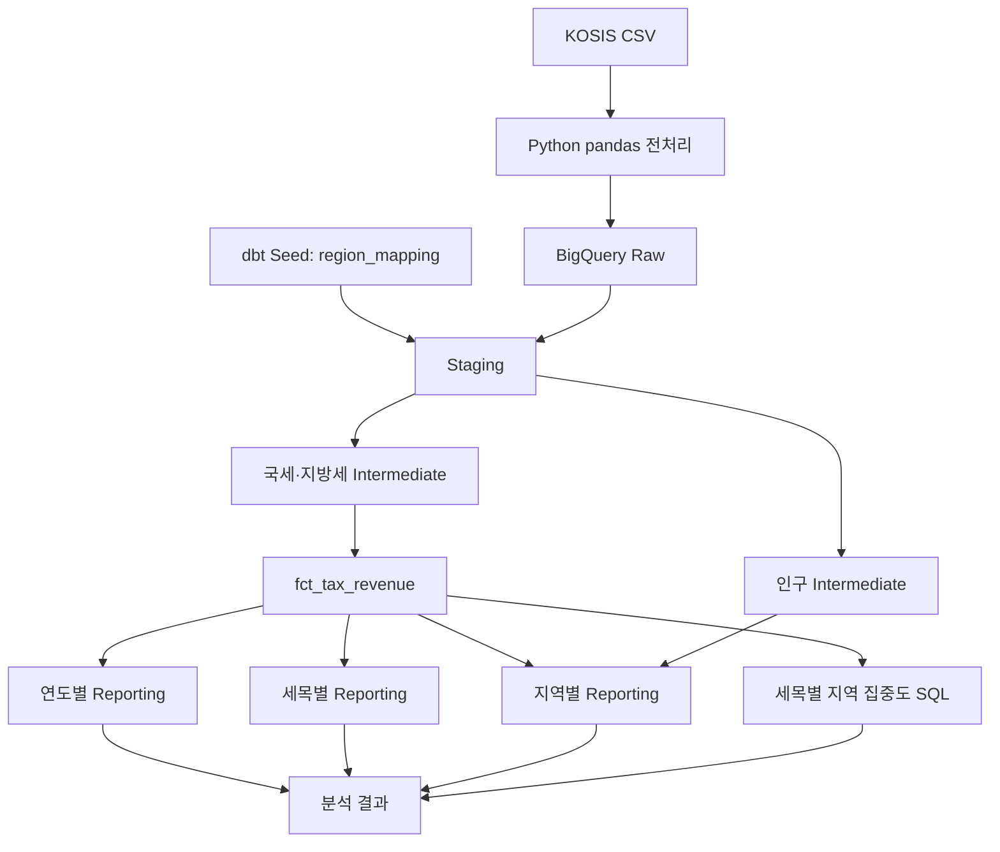

# Tax Revenue Analytics Pipeline

**서로 다른 국세·지방세·인구 데이터를 공통 분석 단위로 통합한 BigQuery·dbt 기반 Analytics Engineering 프로젝트입니다.**

2020~2024년 재정분권 추진기에 세목별 세수 구성과 지역별 집중도가 어떻게 변화했는지 분석합니다. 원천 데이터의 지역 체계와 세목 계층을 정합화하고, 통합 Fact와 재사용 가능한 Reporting 모델을 구축했습니다.

| 구분 | 내용 |
|---|---|
| 분석 범위 | 2020~2024년, 16개 분석 지역(충남·세종 통합), 국세 13개·지방세 11개 세목 |
| 원천 데이터 | KOSIS 국세·지방세 징수실적 및 주민등록인구 |
| 기술 스택 | Python·pandas, BigQuery, SQL, dbt Core·dbt-utils, Git·GitHub |
| 구현 구성 | Staging 4개, Intermediate 3개, Fact 1개, Reporting 3개, Analysis SQL 4개 |
| 개발 기간 | 2026년 9월 1일 ~ 11월 6일 |

[분석 결과](docs/analysis_notes.md) · [모델 설계](docs/modeling.md) · [데이터 범위와 검증](docs/data_scope.md) · [실행 가이드](docs/setup.md)

## 1. 분석 흐름과 주요 결과

재정분권 추진기의 변화를 **전체 세수 구조(Q1) → 주요 세목의 구성·증감(Q2) → 지역별 집중도(Q3)** 순서로 살펴봤습니다.

먼저 전체 세수 중 지방세 비중의 추이를 확인했습니다. 이어 전체 비중만으로 파악하기 어려운 세목별 변화를 분석하고, 서로 다른 특징을 보인 취득세와 지방소비세가 지역별로는 어떻게 분포하는지 비교했습니다. 마지막으로 수도권 세수 비중을 인구 비중과 대조했습니다.

| 분석 질문 | 주요 발견 |
|---|---|
| **Q1. 전체 세수 구조** | 지방세 비중은 2020년 **30.69%** → 2022년 **27.66%** → 2024년 **30.02%** 순으로, 2022년까지 하락한 뒤 반등했습니다. |
| **Q2-1. 세목별 규모·증감** | 국세는 소득세·법인세·부가가치세가 매년 규모 상위 3개 세목이었습니다. 지방세는 2023년 지방소비세가 취득세를 일시적으로 추월했습니다. |
| **Q2-2. 세목별 구성비** | 지방세 내 지방소비세 비중은 **16.28% → 22.91%** 수준으로 상승하고, 취득세는 **29.02% → 23.00%** 수준으로 하락했습니다. |
| **Q3-1. 세목별 지역 집중도** | 2020~2024년 누적 세수의 상위 3개 지역 집중도는 법인세 **81.0%**, 취득세 **61.5%**, 지방소비세 **37.7%** 수준이었습니다. |
| **Q3-2. 수도권 세수·인구 비중** | 2024년 수도권 인구 비중은 **50.86%**, 취득세 비중은 **60.76%**, 지방소비세 비중은 **31.52%** 수준이었습니다. |

**종합 결론:** 전체 세수 중 지방세 비중 자체보다 **지방세 내부의 세목 구성과 지역별 분포 변화**가 더 두드러졌습니다. 지방세 전체의 수도권 비중은 2020년 55.31%에서 2024년 53.91%로 하락했으며, 수도권 집중도가 낮은 지방소비세의 구성비 확대와 연결되는 양상을 확인했습니다.

이는 관찰된 세수 구조의 변화에 대한 분석이지 재정분권 정책의 인과효과를 검증한 결과는 아닙니다. 질문별 계산, 표와 해석은 [Analysis Notes](docs/analysis_notes.md)에 정리했습니다.

## 2. 데이터 파이프라인

KOSIS CSV를 Python으로 전처리해 BigQuery Raw에 적재하고, dbt에서 표준화·통합·지표 계산을 수행했습니다.



- **Staging → Intermediate → Marts:** 원천의 상세 계층을 보존한 뒤 분석에 필요한 grain으로 집계합니다.
- **저장 방식:** Staging·Intermediate는 View, Fact·Reporting은 Table로 구성했습니다.
- **Analysis SQL:** 반복 사용할 지표는 Reporting에 두고, 순위·구성비 변화·지역 집중도 등 질문별 계산은 `analyses/`에서 수행합니다.

> Python 스크립트는 CSV 구조 전처리까지만 담당합니다. BigQuery Raw 적재는 현재 별도 작업이며, 자동 수집·스케줄링 파이프라인은 구현하지 않았습니다.

## 3. 주요 설계 결정

| 해결할 문제 | 설계 및 처리 |
|---|---|
| 원천별 세목 계층과 행 단위가 다름 | Staging에서 원천 계층을 보존하고, Intermediate에서 분석 목적에 맞는 grain으로 집계했습니다. |
| 국세의 지방청 관할과 지역 구분이 다름 | 중부청·인천청으로 나뉜 경기 세수를 합산하고, 형식상 남아 있는 중부청–인천 행을 제외했습니다. |
| 국세와 지방세·인구의 지역 단위가 다름 | 비교 기준을 맞추기 위해 지방세·인구의 충남과 세종을 Intermediate에서 병합했습니다. |
| 세목별 세수에 인구를 바로 결합하면 중복 집계 가능 | 세수를 먼저 `연도 × 지역`으로 집계한 뒤 같은 단위의 인구와 결합했습니다. |
| 데이터 통합과 분석 지표 계산의 책임이 섞일 수 있음 | Fact는 세수 통합, Reporting은 재사용 지표, Analysis SQL은 질문별 계산을 담당하도록 분리했습니다. |

현재 요구사항에서는 지역·세목 속성의 별도 관리나 변경 이력 관리가 제한적이므로 Dimension 테이블은 만들지 않았습니다. 모델별 판단 근거와 처리 단계는 [모델 설계 문서](docs/modeling.md)에 정리했습니다.

## 4. 핵심 데이터 모델

아래 Grain은 **한 행을 유일하게 식별하는 최소 기준**입니다. 현재 분석 대상에서는 국세·지방세에 동명 세목이 없어 `tax_name`이 유형을 구분하며, `tax_type`은 분석용 속성으로 유지합니다.

| 모델 | Grain | 제공 데이터 |
|---|---|---|
| [fct_tax_revenue](models/marts/fct_tax_revenue.sql) | 연도 × 지역 × 세목 | 국세·지방세 구분과 세수액 |
| [rpt_tax_revenue_by_year](models/marts/rpt_tax_revenue_by_year.sql) | 연도 | 국세·지방세 합계, 지방세 비중과 전년 대비 변화 |
| [rpt_tax_revenue_by_tax_name](models/marts/rpt_tax_revenue_by_tax_name.sql) | 연도 × 세목 | 세목별 세수액, 유형 내 구성비, 전년 대비 증감액·증감률 |
| [rpt_tax_revenue_by_region](models/marts/rpt_tax_revenue_by_region.sql) | 연도 × 지역 | 국세·지방세·취득세·지방소비세 금액, 인구수, 수도권 구분 |

세목별 Reporting의 SQL은 `tax_year`, `tax_type`, `tax_name`으로 집계하지만, 현재 데이터에서 `tax_type`은 최소 Grain을 구성하는 추가 식별값이 아닙니다. 수도권 비중·인구 비중의 차이는 지역별 Reporting 자체가 아니라 [별도 분석 SQL](analyses/capital_area_tax_population_comparison.sql)에서 계산합니다.

## 5. 데이터 품질과 공식 통계 검증

- **자동화된 dbt 테스트:** 모델별 Grain 유일성, `not_null`, 허용 범주, 연도별 지방세 비중 범위 등을 YAML에 정의했습니다.
- **개발 중 별도 검증:** 집계 전후 금액과 지역·세목 조합을 확인하고, 원천 통계에서 유효한 음수 세수와 0 값을 임의로 제거하지 않았습니다.
- **공식 통계 교차 검증:** 프로젝트 집계액을 정부 통계와 비교해 차이가 발생하는 범위와 이유를 추적했습니다.

### 공식 통계 비교 결과

2020~2024년 누적 세수 기준입니다. 단위는 **조 원**입니다.

| 구분 | 공식 통계 | 프로젝트 집계 | 차이 |
|---|---:|---:|---:|
| 국세 | 1,706.10 | 1,347.92 | **358.18** |
| 지방세 | 560.00 | 556.95 | **3.05** |

- **국세:** 지역 미배분 수입분내국세(약 289.88조 원), 인지세 및 과년도수입 등이 주요 차이 요인입니다. 다만 **약 46.04조 원의 잔여 차이**를 항목별로 모두 설명한 것은 아닙니다.
- **지방세:** 과년도수입 약 3.01조 원을 포함하면 공식 통계와 거의 일치합니다. 비교 가능한 법정 세목을 유지하기 위해 프로젝트에는 포함하지 않았습니다.
- **비중 해석:** 프로젝트의 지방세 비중은 공식 통계보다 약 4.2~4.7%p 높지만, **2020~2022년 하락 → 2022~2024년 반등**이라는 변화 방향은 일치합니다.

총액을 공식 수치에 맞추기 위해 분석 범위를 임의로 바꾸지 않았습니다. 자동 테스트와 수동 검증의 구분 및 제외 항목은 [데이터 범위·검증 문서](docs/data_scope.md), 조사 과정은 [Issue #7](https://github.com/Kai07790/dbt_project_1_tax/issues/7)에 기록했습니다.

## 6. 재현 방법

프로젝트 실행에는 KOSIS 원본 CSV, Python·pandas, BigQuery 인증, dbt Core 및 BigQuery 어댑터가 필요합니다.

1. 원본 CSV를 `raw_data/`에 준비하고 `python scripts/preprocess.py`로 전처리합니다.
2. 전처리 결과를 BigQuery의 `tax_admin_raw`에 적재하고 `profiles.yml`과 dbt source 설정을 확인합니다.
3. 프로젝트 루트에서 다음 명령을 실행합니다.

```bash
dbt debug --profiles-dir .
dbt deps --profiles-dir .
dbt build --profiles-dir .
```

`dbt build`에는 Seed·모델·테스트가 포함됩니다. `analyses/`의 SQL은 `dbt build` 대상이 아니므로 `dbt compile --profiles-dir .` 이후 컴파일된 SQL을 BigQuery에서 별도로 실행합니다.

Raw 적재와 인증 설정을 포함한 단계별 절차는 [실행 가이드](docs/setup.md)를 참고하세요.

## 7. 해석 범위와 문서 안내

- 본 프로젝트는 **지역별로 구분 가능한 법정 세목**을 분석합니다. 정부가 발표하는 전국 총세수를 그대로 재현하는 데이터셋은 아닙니다.
- 충남·세종은 하나의 분석 지역이며, 금액은 물가 조정을 하지 않은 명목 세수입니다.
- 지역에 귀속된 세수와 인구의 비중 차이는 주민 개인의 실제 세부담이 아니며, 정책 효과·재정형평성 개선을 직접 입증하지 않습니다.

| 문서 | 주요 내용 |
|---|---|
| [Analysis Notes](docs/analysis_notes.md) | Q1~Q3 상세 결과, 해석, 출처 및 참고문헌 |
| [모델 설계](docs/modeling.md) | 레이어별 역할, Grain·컬럼, 모델별 처리와 설계 근거 |
| [데이터 범위와 검증](docs/data_scope.md) | 원천 통계·세목, 포함/제외 기준, 공식 통계와의 차이 |
| [실행 가이드](docs/setup.md) | CSV 전처리, Raw 적재, dbt·Analysis SQL 실행 |
| [Git 복구 기록](https://github.com/Kai07790/dbt_project_1_tax/issues/2) | rebase 과정의 문제와 브랜치 이력 복구 |
